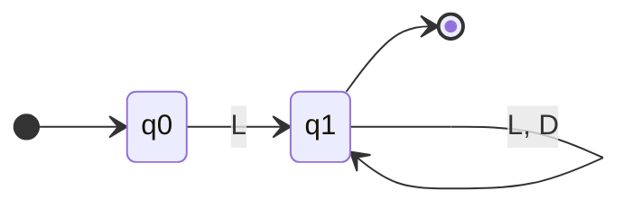
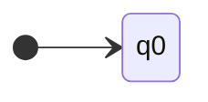

# 05 · Autómatas finitos

El analizador léxico se implementa como un **AFD** que lee el fuente carácter por carácter. Cada clase de token tiene su sub‑autómata; todos parten del mismo estado inicial `q0` y se combinan en el AFD principal (sección final).

**Plantilla por autómata:** ER → diagrama → tabla de transiciones → estados de aceptación → ejemplos aceptados/rechazados → dónde está en el código.

---

## 5.1 AFD de palabras (identificadores y palabras reservadas) — *implementado (provisional)*

> Es lo que hace hoy `Lexer.leerPalabra()`. El equipo puede ajustar el patrón de ID cuando escriba las ER.

**Clases de caracteres:** `L` = letra `[A-Za-z]` o `_` · `D` = dígito `[0-9]`

**ER (provisional):** `L (L | D)*`

**Diagrama:**



Versión texto:

```
         L            L, D
q0 ───────────► (q1) ◄──────┐
                  └─────────┘
```

**Tabla de transiciones:**

| Estado | L | D | Otro |
|---|---|---|---|
| → q0 | q1 | — | — |
| *q1* | q1 | q1 | — (acepta) |

**Estados de aceptación:** `q1`.

**Acción al aceptar:** se busca el lexema en la tabla de palabras reservadas; si está → `PR_*`, si no → `ID` (y se registra en la tabla de símbolos).

| Entrada | Resultado |
|---|---|
| `dome` | ✅ `PR_DOME` |
| `humedadSuelo` | ✅ `ID` |
| `_tmp1` | ✅ `ID` |
| `co2` | ✅ `PR_CO2` |
| `1abc` | ❌ no empieza en este autómata (empieza con dígito) |

**Código:** `backend/src/main/java/bdl/lexer/Lexer.java` → `leerPalabra()`, `esInicioPalabra()`, `esParteDePalabra()`.

---

## 5.2 AFD de espacios en blanco — *implementado*

| Estado | espacio, `\t`, `\r`, `\n` | Otro |
|---|---|---|
| → q0 | qE | — |
| *qE* | qE | — (descarta) |

Se descarta; `\n` incrementa la línea y reinicia la columna.

**Código:** `Lexer.saltarEspacios()`, `Lexer.avanzar()`.

---

## 5.3 AFD de … — *por especificar*

**ER:**

**Diagrama:**



**Tabla de transiciones:**

| Estado | | | Acepta |
|---|---|---|---|
| → q0 | | | No |

**Ejemplos:**

| Entrada | Resultado |
|---|---|
| | |

*(Copiar esta sección para cada clase: números, unidades, ubicaciones, texto, operadores, delimitadores, comentarios.)*

---

## 5.N AFD principal combinado

El autómata completo parte de `q0` y bifurca según el primer carácter leído:

| Primer carácter | Va al sub‑autómata | Tokens posibles |
|---|---|---|
| `L` (letra o `_`) | 5.1 | `ID` o `PR_*` |
| espacio / tab / salto | 5.2 | se descarta |
| … | … | … |
| cualquier otro | — | error léxico *(hoy: `NO_CLASIFICADO`)* |

### Estados de aceptación

| Token | Estados de aceptación |
|---|---|
| `ID` / `PR_*` | q1 |
| | |

### Algoritmo de coincidencia más larga (maximal munch)

Cuando se especifiquen tokens que comparten prefijo (por ejemplo `>` y `>=`), el lexer debe seguir avanzando mientras haya transición, recordar el **último estado de aceptación** visitado y, al atascarse, retroceder hasta él:

```
funcion siguienteToken():
    estado ← q0
    ultimoAceptado ← ninguno
    posAceptado ← ninguna
    mientras haya carácter c y δ(estado, c) esté definida:
        estado ← δ(estado, c)
        avanzar
        si estado es de aceptación:
            ultimoAceptado ← estado
            posAceptado ← posición actual
    si ultimoAceptado = ninguno:
        reportar error léxico
    sino:
        retroceder a posAceptado
        lexema ← texto desde el inicio hasta posAceptado
        si ultimoAceptado es el de palabras y lexema ∈ tablaReservadas:
            devolver token de la palabra reservada
        devolver token asociado a ultimoAceptado
```

---

## Herramientas recomendadas para dibujar

- **JFLAP** (https://www.jflap.org) — permite simular el autómata con cadenas de prueba. Exportar como PNG a `docs/img/`.
- **draw.io** (https://app.diagrams.net) — guardar el `.drawio` y el `.png` en `docs/img/`.
- **Mermaid** — directamente en este archivo (como el ejemplo de 5.1).

Para insertar una imagen: ``
