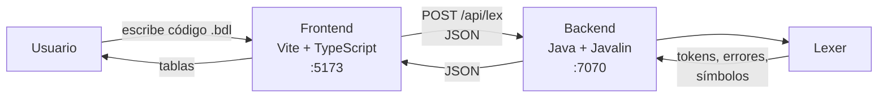

# 07 · Arquitectura del compilador

## Visión general



En desarrollo, Vite redirige `/api/*` al puerto 7070 (`frontend/vite.config.ts`), así que el navegador solo habla con `localhost:5173`.

## Fases del compilador

| Fase | Entrada | Salida | Estado |
|---|---|---|---|
| 1. Análisis léxico | Texto fuente | Tokens + tabla de símbolos + errores léxicos | 🟡 en construcción |
| 2. Análisis sintáctico | Tokens | Árbol sintáctico (AST) + errores sintácticos | ⏳ |
| 3. Análisis semántico | AST | AST validado (tipos/unidades, declaraciones) | ⏳ |
| 4. Simulación / ejecución | AST | Estado del domo, alertas, registros | ⏳ |

## Backend (`backend/`)

| Paquete / clase | Responsabilidad |
|---|---|
| `bdl.lexer.TipoToken` | Enum de todos los tipos de token. Cada palabra reservada guarda su lexema y descripción. |
| `bdl.lexer.PalabrasReservadas` | Mapa `lexema → TipoToken` construido del enum. |
| `bdl.lexer.Lexer` | Recorre el fuente carácter por carácter; produce `ResultadoLexico`. |
| `bdl.lexer.Token` | `(tipo, categoria, lexema, linea, columna)`. |
| `bdl.lexer.Simbolo` | `(nombre, primeraLinea, apariciones)`. |
| `bdl.lexer.ErrorLexico` | `(codigo, mensaje, linea, columna)`. |
| `bdl.lexer.ResultadoLexico` | `(tokens, errores, simbolos)` — es exactamente lo que devuelve la API. |
| `bdl.api.Servidor` | Servidor HTTP Javalin con los endpoints. |

**Dependencias:** Javalin 6.3 (HTTP), Jackson 2.17 (JSON), SLF4J simple (logs), JUnit 5 (pruebas).

Futuras fases irán en paquetes nuevos: `bdl.parser`, `bdl.semantico`, `bdl.simulador`, cada uno con su endpoint (`/api/parse`, ...).

## Frontend (`frontend/`)

| Archivo | Responsabilidad |
|---|---|
| `index.html` | Estructura: editor + pestañas (Tokens, Símbolos, Errores, Palabras reservadas). |
| `src/api.ts` | Interfaces TypeScript que reflejan los records de Java y funciones `fetch`. |
| `src/main.ts` | Editor (números de línea, Tab, Ctrl+Enter), llenado de tablas, saltar a línea. |
| `src/style.css` | Tema oscuro; colores por categoría de token. |

Sin frameworks (TypeScript puro + Vite) para que sea fácil de entender. Si crece, se puede migrar a React y usar Monaco (el editor de VS Code) para resaltado de sintaxis.

## Contrato de la API

### `POST /api/lex`

Petición:
```json
{ "codigo": "sensor temperature temp" }
```

Respuesta:
```json
{
  "tokens": [
    { "tipo": "PR_SENSOR", "categoria": "PALABRA_RESERVADA", "lexema": "sensor", "linea": 1, "columna": 1 },
    { "tipo": "PR_TEMPERATURE", "categoria": "PALABRA_RESERVADA", "lexema": "temperature", "linea": 1, "columna": 8 },
    { "tipo": "ID", "categoria": "IDENTIFICADOR", "lexema": "temp", "linea": 1, "columna": 20 },
    { "tipo": "EOF", "categoria": "FIN", "lexema": "", "linea": 1, "columna": 24 }
  ],
  "errores": [],
  "simbolos": [ { "nombre": "temp", "primeraLinea": 1, "apariciones": 1 } ]
}
```

### `GET /api/reservadas`

```json
[ { "palabra": "dome", "token": "PR_DOME", "descripcion": "Declara un ecosistema artificial." }, ... ]
```

> Si se cambia un record de Java, actualizar también la interfaz equivalente en `frontend/src/api.ts`.

## Proyectos de referencia

En la carpeta padre hay dos compiladores de otros equipos que sirvieron de referencia:

| Proyecto | Lenguaje | Qué tomamos como idea |
|---|---|---|
| MatrixCore | Java + Swing | Tabla de tokens y de errores en la UI, árbol sintáctico visual, parser LL(1) |
| GameScript | Python + Tkinter | Lexer carácter por carácter con línea/columna, catálogo de errores con sugerencias, parser descendente recursivo |
